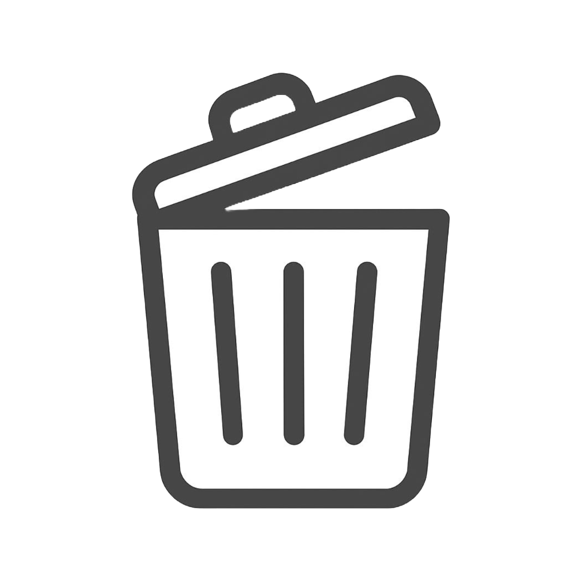

<p align="center">
  
</p>

<h1 align="center">TrashVPN</h1>
<p align="center"><a href="README.md">简体中文</a> · English</p>
<p align="center">
  <a href="https://testflight.apple.com/join/YBg8gqaQ">TestFlight Beta</a>
  · <a href="https://github.com/FuckGFWall/trashvpn-ios">GitHub</a>
  · <a href="LICENSE">GPL-3.0</a>
</p>

**TrashVPN** is a third-party Cloudflare WARP client for Apple devices. Built with SwiftUI and a Mihomo-derived proxy engine, it supports automatic registration, endpoint discovery and optimization, and manual node selection.

Supported platforms: **iOS 16+, iPadOS 16+, and Apple silicon Macs** (running the iPhone / iPad app).

## Features

- **WARP protocols**: WireGuard (WG), AmneziaWG (AWG), and Cloudflare MASQUE (QUIC / HTTP/3).
- **Automatic registration and endpoint selection**: prepares WARP identities and tests available endpoints.
- **Optimization without starting the VPN**: endpoint discovery and quality tests run locally without first connecting the system VPN.
- **IPv4 / IPv6**: choose the address family used to reach WARP endpoints.
- **Node management and export**: automatic or manual node selection, caching, and multiple configuration export formats.
- **Multilingual UI**: Simplified Chinese, Traditional Chinese, English, and Persian.

## Installation

TrashVPN is currently distributed through **TestFlight**.

1. On your iPhone, iPad, or Apple silicon Mac, install [TestFlight from the App Store](https://apps.apple.com/app/testflight/id899247664).
2. After installing TestFlight, open the [TrashVPN TestFlight invitation](https://testflight.apple.com/join/YBg8gqaQ).
3. Accept the invitation in TestFlight and tap **Install**.

**Important: Install TestFlight before opening the invitation link.** If TestFlight is not installed, the invitation page will ask you to download it first.

## Development

### Requirements

- macOS
- Xcode 26 or later
- XcodeGen
- On-device testing requires valid Apple Developer signing and the Network Extension (Packet Tunnel) capability

### Fetch dependencies and generate the Xcode project

```sh
brew install xcodegen
bash Scripts/bootstrap.sh
```

The script downloads the Mihomo-derived Apple SDK, verifies its SHA-256 checksum, and generates the Xcode project.

### Build

```sh
xcodebuild -project TrashVPN.xcodeproj -scheme TrashVPN \
  -destination 'generic/platform=iOS' \
  -derivedDataPath build \
  -allowProvisioningUpdates build
```

You can also open `TrashVPN.xcodeproj` in Xcode and run it on a selected device.

## Technology

- **App**: Swift, SwiftUI
- **Proxy engine**: Mihomo-derived Apple SDK from ProjectClash
- **System integration**: Apple Network Extension (Packet Tunnel)
- **Project generation**: XcodeGen

The integrated SDK version is `v1.19.33-clash.4`. See [Dependencies.lock.json](Dependencies.lock.json) for the pinned version and checksum.

## Acknowledgements

This project references or uses the following open-source projects:

- [ProjectClash/Clash](https://github.com/ProjectClash/Clash) — Mihomo-derived Apple SDK.
- [ProjectClash/Clash-Adapter](https://github.com/ProjectClash/Clash-Adapter) — Packet Tunnel bridge and networking helpers.
- [ProjectClash/Clash-Client](https://github.com/ProjectClash/Clash-Client) — Apple platform integration and framework packaging reference.
- [trashvpn-windows](https://github.com/FuckGFWall/trashvpn-windows) — WARP registration flow, protocol parameters, and endpoint pool reference.
- [usque](https://github.com/Diniboy1123/usque) — MASQUE registration reference.

Thanks to the authors and contributors of these projects.

## License

This project is distributed under the **GNU General Public License v3.0 (GPL-3.0)**. See [LICENSE](LICENSE) for the full license text.

The project also includes the Mihomo kernel and other third-party components. Their notices and license information are available in:

- [Core/NOTICE](Core/NOTICE)
- [Core/THIRD_PARTY_LICENSES.md](Core/THIRD_PARTY_LICENSES.md)
- [Vendor/NOTICE](Vendor/NOTICE)
- [Vendor/THIRD_PARTY_LICENSES.md](Vendor/THIRD_PARTY_LICENSES.md)
- [Vendor/ClashAdapter/LICENSE](Vendor/ClashAdapter/LICENSE)

Please comply with GPL-3.0 and the applicable licenses of all bundled dependencies when redistributing or modifying this project.
