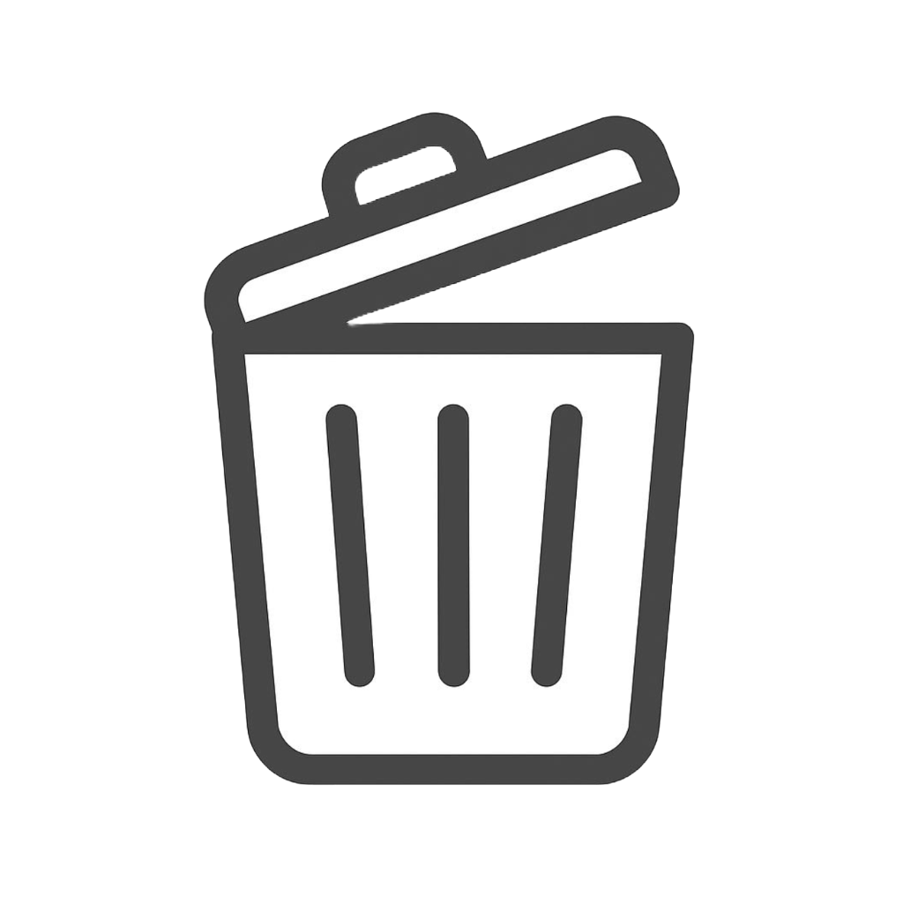

<p align="center">
  
</p>

<h1 align="center">TrashVPN</h1>
<p align="center"><a href="README.md">简体中文</a> · <a href="README.en.md">English</a> · فارسی</p>
<p align="center">
  <a href="https://testflight.apple.com/join/YBg8gqaQ">دریافت از TestFlight</a>
  · <a href="LICENSE">GPL-3.0</a>
</p>

<p dir="rtl"><strong>TrashVPN</strong> یک کلاینت غیررسمی Cloudflare WARP برای دستگاه‌های Apple است. این برنامه به‌صورت بومی با SwiftUI توسعه داده شده و از هستهٔ Mihomo استفاده می‌کند. ثبت‌نام خودکار، شناسایی و بهینه‌سازی نقاط اتصال و خروجی گرفتن از گره‌ها را پشتیبانی می‌کند.</p>

<p dir="rtl">سیستم‌عامل‌های پشتیبانی‌شده: <strong>iOS 15 و بالاتر، iPadOS 15 و بالاتر و رایانه‌های Mac مجهز به Apple silicon</strong>.</p>

## <span dir="rtl">امکانات</span>

<ul dir="rtl" align="right">
  <li><strong>پروتکل‌های مختلف WARP:</strong> ‏WireGuard (WG)، ‏AmneziaWG (AWG) و MASQUE (HTTP/3).</li>
  <li><strong>ثبت‌نام و بهینه‌سازی خودکار نقاط اتصال:</strong> ایجاد خودکار هویت WARP، شناسایی نقاط اتصال در دسترس و آزمایش آن‌ها.</li>
  <li><strong>IPv4 / IPv6:</strong> امکان انتخاب خانوادهٔ آدرس برای اتصال به نقاط ورودی WARP.</li>
  <li><strong>مدیریت و خروجی گرفتن از گره‌ها:</strong> انتخاب خودکار گره با کمترین تأخیر، آزمایش دستی تأخیر و سرعت و خروجی گرفتن از پیکربندی گره‌ها در چندین قالب.</li>
  <li><strong>پشتیبانی از چند زبان:</strong> چینی ساده‌شده، چینی سنتی، انگلیسی و فارسی.</li>
</ul>

## <span dir="rtl">نصب</span>

<p dir="rtl">در حال حاضر TrashVPN از طریق <strong>TestFlight</strong> ارائه می‌شود.</p>

<ol dir="rtl" align="right">
  <li>در iPhone، ‏iPad یا Mac مجهز به Apple silicon، ابتدا <a href="https://apps.apple.com/app/testflight/id899247664">برنامهٔ TestFlight را از App Store دانلود کنید</a>.</li>
  <li>پس از نصب TestFlight، <a href="https://testflight.apple.com/join/YBg8gqaQ">پیوند دعوت TrashVPN در TestFlight</a> را باز کنید.</li>
  <li>دعوت‌نامه را در TestFlight بپذیرید و سپس روی <strong>Install</strong> بزنید.</li>
</ol>

<p dir="rtl"><strong>نکتهٔ مهم: پیش از باز کردن پیوند دعوت، ابتدا TestFlight را نصب کنید.</strong></p>

## <span dir="rtl">توسعه و ساخت</span>

### <span dir="rtl">پیش‌نیازها</span>

<ul dir="rtl" align="right">
  <li>macOS</li>
  <li>Xcode 26 یا جدیدتر</li>
  <li>XcodeGen</li>
  <li>برای آزمایش روی دستگاه واقعی، امضای معتبر Apple Developer و مجوز Network Extension (Packet Tunnel) لازم است.</li>
</ul>

### <span dir="rtl">دریافت وابستگی‌ها و تولید پروژهٔ Xcode</span>

```sh
brew install xcodegen
bash Scripts/bootstrap.sh
```

<p dir="rtl">این اسکریپت SDK مشتق‌شده از Mihomo برای Apple را دانلود می‌کند، مقدار SHA-256 آن را بررسی می‌کند و پروژهٔ Xcode را تولید می‌کند.</p>

### <span dir="rtl">ساخت</span>

```sh
xcodebuild -project TrashVPN.xcodeproj -scheme TrashVPN \
  -destination 'generic/platform=iOS' \
  -derivedDataPath build \
  -allowProvisioningUpdates build
```

<p dir="rtl">همچنین می‌توانید فایل <code>TrashVPN.xcodeproj</code> را در Xcode باز کنید، دستگاه موردنظر را انتخاب کرده و برنامه را اجرا کنید.</p>

## <span dir="rtl">فناوری‌های مورد استفاده</span>

<ul dir="rtl" align="right">
  <li><strong>رابط کاربری:</strong> Swift و SwiftUI</li>
  <li><strong>هستهٔ پراکسی:</strong> SDK مشتق‌شده از Mihomo که توسط ProjectClash ارائه شده است.</li>
  <li><strong>یکپارچه‌سازی با سیستم:</strong> Apple Network Extension (Packet Tunnel)</li>
  <li><strong>تولید پروژه:</strong> XcodeGen</li>
</ul>

<p dir="rtl">نسخهٔ هستهٔ یکپارچه‌شده <code>v1.19.33-clash.4</code> است. نسخه و مقدار checksum در فایل <a href="Dependencies.lock.json">Dependencies.lock.json</a> درج شده‌اند.</p>

## <span dir="rtl">قدردانی</span>

<p dir="rtl">این پروژه از پروژه‌های متن‌باز زیر استفاده کرده یا از آن‌ها الهام گرفته است:</p>

<ul dir="rtl" align="right">
  <li><a href="https://github.com/ProjectClash/Clash">ProjectClash/Clash</a> — ‏SDK مشتق‌شده از Mihomo برای Apple.</li>
  <li><a href="https://github.com/ProjectClash/Clash-Adapter">ProjectClash/Clash-Adapter</a> — پل ارتباطی Packet Tunnel و ابزارهای کمکی شبکه.</li>
  <li><a href="https://github.com/ProjectClash/Clash-Client">ProjectClash/Clash-Client</a> — مرجع یکپارچه‌سازی با پلتفرم‌های Apple و بسته‌بندی فریم‌ورک.</li>
  <li><a href="https://github.com/FuckGFWall/trashvpn-windows">trashvpn-windows</a> — مرجع فرایند ثبت‌نام WARP، پارامترهای پروتکل و مجموعهٔ نقاط اتصال.</li>
  <li><a href="https://github.com/Diniboy1123/usque">usque</a> — مرجع فرایند ثبت‌نام MASQUE.</li>
</ul>

<p dir="rtl">از نویسندگان و مشارکت‌کنندگان این پروژه‌ها سپاسگزاریم.</p>

## <span dir="rtl">مجوز</span>

<p dir="rtl">این پروژه تحت مجوز <strong>GNU General Public License نسخهٔ 3.0 (GPL-3.0)</strong> منتشر می‌شود. متن کامل مجوز در فایل <a href="LICENSE">LICENSE</a> قرار دارد.</p>

<p dir="rtl">این پروژه همچنین شامل هستهٔ Mihomo و اجزای شخص ثالث دیگری است. اعلان‌های حق‌نشر و اطلاعات مجوز آن‌ها در فایل‌های زیر موجود است:</p>

<ul dir="rtl" align="right">
  <li><a href="Core/NOTICE">Core/NOTICE</a></li>
  <li><a href="Core/THIRD_PARTY_LICENSES.md">Core/THIRD_PARTY_LICENSES.md</a></li>
  <li><a href="Vendor/NOTICE">Vendor/NOTICE</a></li>
  <li><a href="Vendor/THIRD_PARTY_LICENSES.md">Vendor/THIRD_PARTY_LICENSES.md</a></li>
  <li><a href="Vendor/ClashAdapter/LICENSE">Vendor/ClashAdapter/LICENSE</a></li>
</ul>

<p dir="rtl">هنگام بازتوزیع یا تغییر این پروژه، لطفاً GPL-3.0 و مجوزهای مربوط به تمام وابستگی‌های همراه آن را رعایت کنید.</p>
